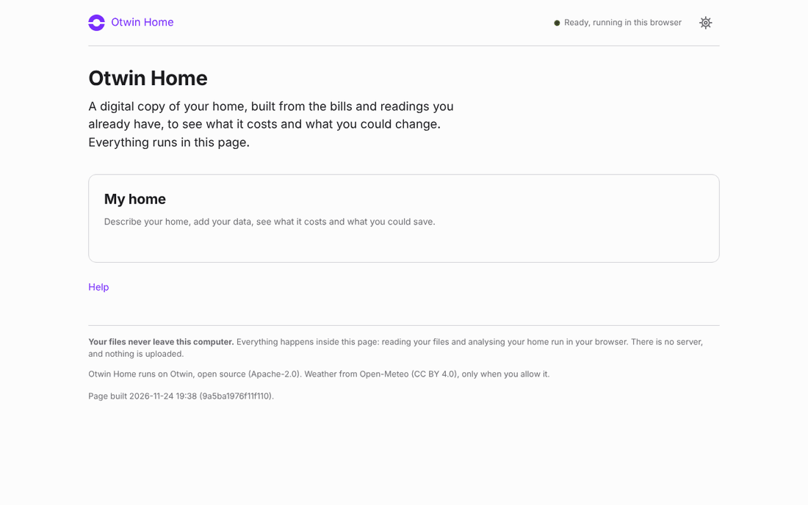

<div align="center">


<br><br>

[](https://otwin-core.github.io/otwin-home/)
[](https://github.com/otwin-core/otwin-home/actions/workflows/ci.yml)
[](https://github.com/otwin-core/otwin-home/attestations)
[](LICENSE)
</div>

# Otwin Home

A digital copy of your home, built in your browser from the bills and
readings you already have: what the home costs, how well it keeps the heat,
and what would change with a heat pump, insulation, air conditioning or
another thermostat. Everything happens inside the page — your files never
leave your computer.

**[Open Otwin Home](https://otwin-core.github.io/otwin-home/)** — it runs in
the browser, with nothing to install.

<div align="center">



<sub>A demo home, from its bills to the simulation. Your own home works the
same way: add your bills, build your digital home, and simulate the
changes.</sub>

</div>

## What you can do

1. **Describe your home** with a few controls (province, type, m², year,
   heating, temperatures, people, appliances), or start from a demo home
   whose bills are its own. The page answers at once with a first estimate:
   a traffic light for how well the home keeps the heat, what a month
   costs, and the home card.
2. **Build your digital home.** Add your hourly electricity (free from
   Datadis or your supplier), the weather of those days (fetched once you
   say yes), and, if you have them, gas bills, water bills or a
   thermometer's log. Bills come as a photo or a PDF and are read in the
   page; you check the numbers before they count. The result says how well
   your digital home matches your own meters, and how sure it is.
3. **Simulate the next twelve months** on an average year's weather, as the
   home is today, and beside it up to three changes — a heat pump instead
   of the boiler, insulation, another temperature — each a curve with its
   band, in euros or kWh.

Otwin Home is its own project. It runs on
[Otwin](https://github.com/otwin-core/otwin), the open-source physics
engine, which it installs from PyPI, and it follows its own design guide,
[DESIGN.md](DESIGN.md), built on the Otwin identity.

- [ARCHITECTURE.md](ARCHITECTURE.md): how it is built, layer by layer, and
  the choices behind it.
- [CHANGELOG.md](CHANGELOG.md): what changed, by session.

## Your files never leave this computer

There is no server. Reading your files and analysing your home run inside
the browser, and nothing is uploaded. The only network request the page can
make is the weather for your dates, from Open-Meteo, and only when you
allow it.

## Build, serve, test

```bash
pip install -r requirements-dev.txt   # Otwin, NumPy, SciPy, pytest, ruff
python web/build_bundle.py            # builds ui/ with Vite too; dist/ ≈ 90 MB
python -m http.server -d web/dist     # any static server works; dist/index.html opens from disk too
python -m pytest tests                # the engine, natively (about 200 tests)
python web/verify_wizard.py           # the page, in a real Chrome (pip install playwright)
```

The build needs Node (for Vite) and downloads, once, into
`~/.cache/otwin-home-web`: Pyodide, the NumPy and SciPy wheels, and the OCR
models. It also bakes the demo homes' fits (`demos.js`) and embeds the OCR
models and runtime (`ocr-assets.js`). `build_bundle.py --check` says
whether `dist/` matches the sources. Publishing to GitHub Pages is the
manual workflow `.github/workflows/home-pages.yml`.
